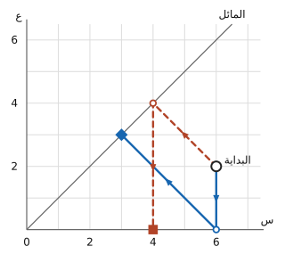

# سجل تطوّر الفكرة في المحادثة

تتناول الأقسام السبعة الأولى نشأة الفكرة حتى 21/11/2026، ثم يتابع السجل ما أضافته الدراسات اللاحقة. جُرّبت قواعد مختلفة أثناء العمل، ثم أعاد صاحب الفكرة تحديد النواة. تُقرأ كل تجربة وفق الفرضيات التي كانت مستعملة عند بنائها. [النواة بصيغتها الأصلية](../README.md)

## ١. حاصل ضرب يعرف أصله

بدأ السؤال من $+6$ و$+2$. قد تُقرأ النتيجة العددية $+12$ في الحالتين، ومع ذلك نريد تمييز $12_{(6,2)}$ عن $12_{(2,6)}$ والعودة إلى العاملين بترتيبهما. ظهر فرق بين ملاحظة قياسٍ واحد ومعرفة البناء الفعلي الذي أدّى إليه. وترتيب العاملين في التعبير يختلف أيضًا عن توقيت قياس كل واحد في الواقع.

## ٢. التفاح والإجاص والتكرار

أمكن جمع تفاحتين مع تفاحتين تحت نوع التفاح. أمّا التفاحتان والإجاصتان فيمكن عدّهما أربع ثمرات عند رفع الهوية إلى الفاكهة، أو أربعة أشياء عند اختيار ذلك التجريد. يظل «عدّ التفاحات الست» مختلفًا عن «عدّ دفعة التفاح الواحدة». وفي الضرب تفاعل عدد التفاحات مع عدد مرّات أخذ الدفعة. اختلاف التفاح والإجاص في الطبيعة وحده لا يعيّن بينهما قاعدة ضرب.

في أول مختبر فُحصت الدفعات والتكرارات من 1 إلى 12. كانت هناك 144 عملية أعطت 59 عددًا مختلفًا، واستُعيد العاملان بالترتيب في الحالات الـ144. كما أمكن التمييز بين دفعتين مختلفتين كرّرت كل منهما صفر مرة، عند فتح ناتجيهما الصفريين. [المختبر الأول للعدّ والمستوى](../history/quantity-history-lab-v1.html)

## ٣. الضرب الهندسي وأثر القياس

اقترح صاحب الفكرة قطعتين طول كل واحدة متران على محورين متعامدين، فتحصّلنا على مربع مساحته أربعة أمتار مربعة. قطعتان على المحور نفسه لا تولّدان سطحًا ذا بُعدين. ثم استكشفنا قاعدة أوسع تُنشئ متوازي أضلاع من إزاحتين مستقلتين. كانت المساحة المعتادة القيمة المطلقة للمحدّد، وكانت إشارته تسجّل اتجاه دوران الضلع الأول إلى الثاني. كان الحكم عند التوازي «بناء سطح غير معرّف»، بينما تعطي صيغة المحدّد صفرًا.

اختبرنا الشريط المدهون بعرض متر واحد. عند الذهاب ستة أمتار والعودة مترين فوق المسار نفسه نحصل على ثلاث قراءات قابلة للتفسير.

| ما نقيسه | النتيجة | تفسيرها |
|---|---:|---|
| المساحة الموجّهة الصافية | 4 م² | مساهمة الذهاب موجبة ومساهمة العودة سالبة |
| مساحة العمل مع احتساب المرور المتكرر | 8 م² | احتساب كل مرور للفرشاة |
| مساحة الأرض التي وصل إليها الطلاء مرة على الأقل | 6 م² | تغطية الأجزاء المتداخلة مرة واحدة |

في الاختبار أخذت كلٌّ من الحركتين مقدارًا صحيحًا من 1 إلى 6 شرقًا أو غربًا. من 144 زوجًا، تساوت المساحة المعتادة قبل التوزيع وبعده في 72 حالة، واختلفت في 60. وفي 12 حالة ألغت حركةٌ الأخرى فتعذّر إنشاء سطح من الإزاحة الصافية. اتفقت القراءة الموجّهة في الحالات الـ132 التي عُرّف فيها الطرفان.

استُعمل كذلك الإسقاط العمودي $H$ على المحور الأفقي والإسقاط العمودي $D$ على المستقيم $y=x$. انطلاقًا من $(6,2)$ ينتهي الأفقي ثم المائل عند $(3,3)$، والمائل ثم الأفقي عند $(4,0)$. هنا يظهر أثر تغيير الترتيب بالنظر إلى موضع النهاية نفسه. أُعيد الاختبار على شبكة الإحداثيات الصحيحة من −5 إلى 5 في كل محور، فاتفق الترتيبان عند الأصل وحده من أصل 121 نقطة. [التجربة التفاعلية المستخرجة من الرسم الأصلي](../history/projections.html)



## ٤. الإشارات والشرطات

اقترح صاحب الفكرة الأمثلة الآتية. نحافظ على مواقع الشرطات، ونستعمل علامة الضرب لعرضها.

```text
+'1  × -1  = +-1
-'1  × +1  = -+1
+'1  × +1  = ++1
-'1  × -1  = --1
+''1 × +'1 = ++'1
++'1 × +1  = +++1
-+'1 × -1  = -+-1
```

استكشفنا أولًا قراءة تضيف إشارة في كل خطوة. في كلمة نعرف أنها أُنشئت بإلحاق إشارة واحدة في النهاية، يمكن حذف الإشارة الأخيرة لاسترجاع الخطوة. لثماني خانات ثنائية 256 كلمة. وعند السماح بعامل أيمن مركّب تصبح معرفة موضع الفصل بين العاملين مسألة أخرى. لم يُتّخذ هذا النمط اللفظي مسلّمة في الحساب.

## ٥. متى يرفع خطٌّ مربعًا إلى مكعب؟

أوضح صاحب الفكرة أن `++1` مربع. وردت أولًا فرضية منع ضرب المربع في خط، ثم صحّحها صاحبها. يمكن للقطعة أن ترفع المربع إلى مكعب إذا أضافت بُعدًا خارج مستواه. وفي الهندسة الإقليدية يلزم للمكعب تحديدًا أن تكون القطعة عمودية على مستوى القاعدة وطولها مساويًا لطول ضلعها. الامتداد المائل يكوّن منشورًا مائلًا، والامتداد العمودي بارتفاع مختلف يكوّن منشورًا قائمًا ذا قاعدة مربعة.

في تجربةٍ محددة ثبّتنا أصلًا وثلاثة محاور متعامدة. تشير `+1` و`+'1` و`+''1` إلى قطع الوحدة على هذه المحاور، وتعكس إشارة السالب جهة القطعة. صار كلٌّ من `++1` و`++'1` مربعًا في مستوى مختلف. تُرفض `(++1) × (+1)` لبناء مكعب، وتُقبل `(++'1) × (+1)` و`(++1) × (+''1)`. تشغل النتيجتان الأخيرتان الموضع نفسه، وتكشف ذاكرتهما قاعدتين مختلفتين. اختير هذا التفسير للشرطات في التجربة، ويمكن دراسة اصطلاحات أخرى.

اختُبرت 24 طريقة مرتبة لبناء قاعدة موجهة، ثم كل واحدة من القطع الست بوصفها امتدادًا لها. نجحت 48 محاولة من 144 وتعذّرت 96. أعطت المحاولات الناجحة ثمانية مواضع للمكعب حول الأصل وستة سجلات لكل موضع. استُعيد ترتيب القطع الثلاث في الحالات الـ48. [المختبر الموسّع للمربعات والمكعبات](../history/quantity-history-lab.html)

## ٦. مراجعة النماذج بعد تثبيت النواة

أعاد صاحب الفكرة التأكيد على تنافي الجمع والضرب **لنفس الزوج عند تثبيت وصفه**. أظهرت إعادة تشغيل المختبر القديم موضعين يحتاجان إلى تصحيح في أي نموذج يراد له تحقيق هذه القراءة.

| الشاهد من الأرشيف | ما أجازه المختبر التاريخي | حكم المسلّمات المثبّتة |
|---|---|---|
| `side(1,0)` و`side(0,1)` | جمع إزاحتين، وضرب الإزاحتين نفسيهما لإنشاء مساحة | تقاطع صريح بين مجالي العمليتين |
| `apple(2)` و`times(2)` | رفعًا آليًا إلى «شيء» عند الجمع، وتكرار التفاح عند الضرب | إذا عُدّ الجمع المرفوع جمعًا أصليًا وقع التداخل. يتطلب الوصف الجديد تحويلًا ظاهرًا ومبرّرًا |

يحتفظ الأرشيف بهذه السلوكيات لإمكان مراجعتها. ويجري [النموذج الصارم](core.md) والفحص البرمجي الجديد على قواعد محددة للطبيعة والتحويل. يدل اختلاف الإزاحتين في اتجاههما على خاصية هندسية قابلة للقياس. ولا يكفي إطلاق اسمي «أيسر» و«أيمن» عليهما بعد اختيار العملية لإثبات اختلاف طبيعتيهما.

## ٧. العلب والمسامير والذاكرة

نُقلت الدراسة إلى شحنات ذات تعبئة موحّدة. اشتُقّ الضرب العددي من تجزئة عدد العلب وتجزئة محتوى العلبة ومعايرة الوحدة. وثبت أن حفظ العاملين المرتّبين يميّز حاصلَي الترتيبين متى أُجيزا معًا. ولعدد موجب من المسامير وعمليّة واحدة ذات نوعين معلومين، خلصنا إلى أن تحديد قاسم موجب للنتيجة يكفي لاسترجاع الزوج. وعند توالي الخطوات احتجنا أيضًا إلى بنية التجميع. فالرزمتان، وثلاث علب لكل رزمة، وأربعة مسامير لكل علبة تعطي 24 مسمارًا. آخر عاملين قد يكونان «٦ علب، ٤ مسامير للعلبة» أو «رُزمتان، ١٢ مسمارًا للرزمة».

ورد في النقاش مثال توثيق دور المدخل في معيار W3C، الذي يسجّل أن خلية استُعملت بوصفها مقسومًا عليه. هذا شاهد على إمكان تسجيل الدور في تطبيق قائم. [معيار PROV-DM، المثال 50](https://www.w3.org/TR/prov-dm/#term-attribute-role)

أضيف عند تأسيس المستودع برهان تعارض المحايد التام مع فكّ الضرب، ودراسة التواريخ المتكررة ذات القيمة الواحدة وترميزها، ثم معيار الدورات عند تعدّد الأنواع. [البراهين ونتائج إعادة الاختبار](results.md)

## ٨. من رفع الهوية إلى التعويض داخل العملية

عاد النقاش إلى التفاح والإجاص. اتفقت طلبيتان في العدد أمام كل تعليمة منفردة، ثم اختلفتا عند وسم التفاح ومضاعفة المطلوب من الموسوم. وعندما أضيف فحص زوجية التفاح ثبت أن أربع حالات تكفي لمعرفة جميع السلاسل الجائزة. وفي 22/11/2026 انتقل السؤال إلى أثر ضمّ شريك جديد على اليسار أو اليمين. في ورشة الدزينة أمكن حساب أقل وصف يكفي للتعويض، وعدّ أزواج فئات العاملين التي يدمجها كل باقٍ عند القياس. [تجربة رفع الهوية](identity-lift.md) · [التعليمات المشروطة](guarded-orders.md) · [ورشة الدزينة](contextual-equality.md)

## ٩. ما بقي من تاريخ الدفعات بعد جمعها

في 22/11/2026 انتقلنا من فكّ دفعة واحدة إلى شحنة من ثمانية مسامير يمكن تعبئتها بثلاث طرق إذا علمنا أن فيها دفعتين ولكل دفعة أحد نمطين معروفين. قاد المثال إلى تمييز سؤالين، أحدهما عن العاملين داخل كل دفعة، والآخر عمّا ضُمّ إلى ماذا في آخر جمع. وثّقنا برهان الدفعات الأربع وحدّ الذاكرة في ورشة الدزينة، ثم اختبرنا جمع علب سائبة مع علب جاءت من رزم قبل تعبئتها بالمسامير. [الدراسة وتجربة الاسترجاع](memory-after-addition.md)

## ١٠. من سجل المعدلات إلى أحجام الدفعات الأصلية

في 22/11/2026 درسنا أربع علب متساوية المعدل. أمكن ردّ صور وصولها الخمس إلى تقسيمات العدد أربعة، واحتجنا إلى بتّ واحد حين عُلم أنها دفعتان موجبتان. وعند معدلين كشف تسجيل صفر علبة أمرًا آخر، إذ يمكن أن نعرف عدد الطلبات الصفرية ونظلّ نجهل أيّ معدل حُدّد لكل منها. عُمّم العدّ على جدول معدلات معلوم وبُني ترميز يعيد الأحجام في كل خانة. [الدراسة وتجربتا العلب والطلبات الصفرية](batch-receipts.md)
