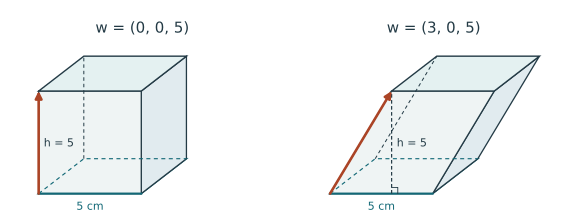

# ما الذي يجب أن نعرفه قبل ضرب مربع في قطعة؟

خذ مربعًا من الورق طول ضلعه 5 سم. تخيّل تحريكه من سطح الطاولة إلى أعلى مسافة 5 سم، ثم تخيّل حركة ثانية تبلغ الارتفاع نفسه وتزيحه جانبيًّا 3 سم. في الحركتين يمسح المربع حجمًا قدره 125 سم³. الحركة الأولى تولّد مكعبًا، والثانية تولّد منشورًا مائلًا. يتيح لنا هذا المثال اختبار ثلاث معلومات كلٌّ على حدة، هي جواز البناء، والقياس، والعاملان اللذان يردّهما فكّ السجل.



## ما المقصود بالضرب هنا؟

نعمل في الفضاء الإقليدي الثلاثي. نعطي ضلعَي القاعدة بمتجهين مرتّبين $a,b$ من نقطة واحدة، متعامدين ومتساويين في الطول $s>0$. نكتب $P=\operatorname{span}(a,b)$ لمستوى **اتجاهات** المربع، و$N=P^\perp$ للمستقيم العمودي عليه. يمثّل $w$ الإزاحة التي تتحرّك بها القاعدة كلّها. الجسم الممسوح هو مجموعة النقاط $p+tw$ حيث $p$ نقطة من المربع و$0\le t\le1$. بذلك يكون موقع رسم سهم الإزاحة على الورقة اختياريًّا، ويظلّ اتجاه الحركة وطولها محدّدين.

نعرّف ثلاث قواعد محتملة على الزوج المرتّب «مربع، قطعة». قاعدة المكعب هي موضوع اقتراح صاحب الفكرة. تتيح القاعدتان الأخريان تعيين ما يترتب على شرط «يضيف بُعدًا» وحده ثم على إضافة شرط التعامد. نرمز بـ $n=a\times b$ لمتجه عمودي غير صفري.

| البناء المطلوب | شرط جوازه |
|---|---|
| جسم ثلاثي الأبعاد ذو حجم موجب | $w\notin P$، أي $n\cdot w\ne0$. |
| منشور قائم ذو قاعدة مربعة | $w\in N$ و$w\ne0$. |
| مكعب | $w\in N$ و$\lVert w\rVert=s$. |

حين ينجح البناء يكون الارتفاع $h=|n\cdot w|/\lVert n\rVert$، والحجم $V=s^2h=|n\cdot w|$. وإذا كانت الإزاحة داخل مستوى القاعدة أعطت الصيغة العددية صفرًا وتعذّرت عملية إنشاء جسم ثلاثي الأبعاد. يُستبعد المربع المنعدم الضلع، وتفشل الإزاحة الصفرية في القواعد الثلاث. [صيغة الحجم وبرهانها في OpenStax](https://openstax.org/books/calculus-volume-3/pages/2-4-the-cross-product) · [التعريف الإقليدي للمكعب](https://mathworld.wolfram.com/Cube.html)

### ماذا يحدث عند تغيير عامل واحد؟

القاعدة في كل صف مربع في المستوى $xy$ طول ضلعه 5 سم. إحداثيات الإزاحة بالسنتيمتر.

| الإزاحة $w$ | جسم ذو حجم | منشور قائم | مكعب | الحجم عند نجاح البناء |
|---|---|---|---|---:|
| $(5,0,0)$ | لا | لا | لا | — |
| $(3,0,4)$ | نعم | لا | لا | 100 سم³ |
| $(0,0,3)$ | نعم | نعم | لا | 75 سم³ |
| $(0,0,5)$ | نعم | نعم | نعم | 125 سم³ |
| $(3,0,5)$ | نعم | لا | لا | 125 سم³ |
| $(0,0,-5)$ | نعم | نعم | نعم | 125 سم³ |

طول $(3,0,4)$ هو 5 سم، تمامًا كطول $(0,0,5)$، ومع ذلك يختلف حكم المكعب. والإزاحة $(0,0,3)$ عمودية لكن طولها أصغر من ضلع القاعدة. ويمكن أيضًا تثبيت القطعة $(0,0,5)$ وتغيير مستوى **المربع** وحده من $xy$ إلى $xz$. عندئذ تقع الحركة كلّها في مستوى القاعدة. هذه مقارنات يمكن فحصها بقياس الطول والارتفاع واتجاه الحركة.

## معيار عام لأقلّ وصف كافٍ

لتكن $R(x,y)$ إجابة السؤال «هل يجوز هذا البناء بهذا الترتيب؟». نثبّت مسبقًا مجموعة المرشّحين في كل دور. نصف مدخلين في الدور الأول بأنهما متكافئان في هذا الاختبار عندما يتحقق

$$
x\sim_X x' \quad\Longleftrightarrow\quad
\forall y,\ R(x,y)=R(x',y).
$$

ونعرّف $\sim_Y$ في الدور الثاني بتثبيت $y,y'$ وتغيير $x$. المقصود بـ«أقلّ» هو إمكان إعطاء الوصف نفسه لأكبر مجموعة من المدخلات من دون أن يخطئ أي حكم. عند تقييد الشركاء بمربع واحد، مثلًا، يكفي للقطعة وصف ثنائي هو «تصلح لهذا المربع» أو «يتعذّر استعمالها معه». نطلب في النتيجة الآتية وصفًا يمكن إعطاؤه لكل عامل **قبل معرفة شريكه** ويعمل مع جميع الشركاء المعلنين.

**البرهان.** إذا اختلف صفّا $x,x'$ في جدول $R$، وُجد شريك واحد على الأقل يقبل أحدهما ويرفض الآخر. كل وصف يجمعهما سيعطي الحكم نفسه للزوجين، فيخطئ في أحدهما. والحجة نفسها للأعمدة. وبالعكس، إذا اتفق الصفّان أمكن استبدال $x$ بـ $x'$ مع إبقاء $y$، وإذا اتفق العمودان أمكن بعد ذلك استبدال $y$ بـ $y'$ مع إبقاء $x'$. لذلك يحدّد زوج الفئتين الحكم تحديدًا تامًّا. وعند دراسة عدّة عمليات أو كلا ترتيبَي التفاعل تُقارَن الإجابات لكل عملية وموضع معلنين. وفي الجدول المنتهي، إذا كان عدد الصفوف المختلفة $m>0$، كان الحدّ الأدنى لوصف الطرف الأول بكلمات ثنائية متساوية الطول هو $\lceil\log_2 m\rceil$ خانة. [ترد صيغة عدد الصفوف أيضًا في عمل Hartmut Klauck عن الاتصال أحادي الاتجاه، النتيجة 2.7](https://arxiv.org/pdf/cs/0111062)

## أقل وصف للمربع وللقطعة في الفضاء الثلاثي

نفترض إتاحة جميع المربعات ذات الضلع الموجب وجميع الإزاحات غير الصفرية. نكتب $L=\operatorname{span}(w)$ للمستقيم الحامل لاتجاه الإزاحة، و$\ell=\lVert w\rVert$ لطولها. المستقيمان $L,N$ غير موجّهين، أي إن عكس جهة سهمٍ على مستقيم يُبقي المستقيم نفسه.

| الاختبار | أقلّ وصف للمربع في دوره | أقلّ وصف للقطعة في دورها |
|---|---|---|
| إضافة بُعد ثالث | مستوى الاتجاهات $P$ | المستقيم $L$ |
| إنشاء منشور قائم | $P$، أو بصورة مكافئة عموده $N$ | $L$ |
| إنشاء مكعب | $(P,s)$ | $(L,\ell)$ |

**لماذا يلزم اتجاه المستوى؟** في اختبار إضافة البُعد، إذا اختلف مستويان أمكن اختيار قطعة اتجاهها في الأول وخارج الثاني. وإذا اختلف اتجاه قطعتين أمكن اختيار مستوى يحوي اتجاه الأولى ويستبعد اتجاه الثانية. ينجح رفع أحد الزوجين إلى جسم ذي حجم ويتعذّر الآخر. أمّا في اختبار المنشور القائم، فعمود أحد المستويين يميّزه عن أي مستوى آخر، والمستوى العمودي على إحدى القطعتين يميّزها عن أي قطعة غير موازية.

**لماذا يلزم طول الضلع للمكعب؟** المربع ذو الضلع $s$ يقبل بالضبط متجهَي الإزاحة $+s\hat n$ و$-s\hat n$، حيث $\hat n$ أحد متجهَي الوحدة على $N$. إذا اختلف المستوى أو طول الضلع اختلفت مجموعة القطع المقبولة. وفي الطرف الآخر تستطيع أي قطعة أن تختبر نفسها بمربع عمودي عليها طول ضلعه يساوي طولها. يرفض هذا المربع أي قطعة يختلف خطّها أو طولها. ويجوز حفظ مربع الطول أو مساحة القاعدة بدل طول ضلعها لأن الطول موجب. يثبت بذلك أن المعلومات الواردة في الجدول كافية وضرورية، حتى مع السماح بترميزها على نحو مختلف.

**نتيجة تخص نواة المشروع.** إذا اشترطنا أن يكفي اسم نوعٍ من قائمة منتهية لكل مدخل، وأن يحسم جدول الأسماء وحده الجواز، تعذّر تمثيل جميع هذه المكعبات تمثيلًا دقيقًا. يكفي تثبيت مستوى واحد وتغيير طول الضلع بين أعداد صحيحة موجبة. لكل طول قطعة تقبله وتُرفض مع سائر الأطوال. يمكن مع ذلك كتابة قاعدة هندسية واحدة تفحص التعامد وتساوي الطولين. بهذا المعنى نستطيع الاحتفاظ بنوعين أساسيين «مربع» و«قطعة»، مع خصائص قابلة للقياس تفحصها القاعدة. وتتضح صلة ذلك بآلة التعبئة التي تقبل الدفعات الزوجية، حيث يكفي تمييز الزوجي والفردي للحكم على الدفعة في ذلك الاختبار. [حدود نموذج الصفر](zero-histories.md)

## جواز العملية وذاكرة ناتجها

الزوج «مربع، قطعة» مختلف الطبيعة، ولا نعرّف جمعًا له. يجيز النموذج الهندسي الضرب بالترتيب المعلن إذا نجح اختبار الهدف. وإذا اجتاز الزوج عدّة اختبارات فله سجل بناء واحد بالمدخلين نفسيهما. تُقرأ أضلاع القاعدة بوصفها أطوالًا موجّهة على مستقيمات معيّنة، ويضمن تعامد الضلعين اختلاف حامليهما. تُستعمل عمليات الإحداثيات في حساب الشكل وقياسه. [صلة ذلك بتنافي مجالي الجمع والضرب](core.md)

**في ترميز قطع الوحدة على المحاور الثلاثة** يمكن اختصار وصف المربع المخصّص للجواز إلى **اسم المحور الغائب عن قاعدته**. قاعدة في $xy$ تشترط محور $z$، وقاعدة في $xz$ تشترط محور $y$، وقاعدة في $yz$ تشترط محور $x$. هذه ثلاث حالات ضرورية، وتكفي خانتان ثنائيتان لترقيمها. داخل كل حالة ثمانية سجلات لبناء المربع، لأن ترتيب ضلعَيه له خياران، ولكل ضلع جهتان. إذا عرفنا المحور الغائب وأردنا استرجاع سجلّ القاعدة نفسه احتجنا إلى ثلاث خانات إضافية في ترميز ثابت الطول للخيارات الثمانية.

قد يختلف سجلان حتى إذا تطابق **المجسّم بموضعه**. خذ قطع الوحدة الموجبة $x,y,z$ الخارجة من الأصل. نكوّن قاعدة من $x,y$ ونمدّها بـ $z$. ثم نكوّن قاعدة من $x,z$ ونمدّها بـ $y$. في المرتين تشغل النتيجة المكعب نفسه $[0,1]^3$. يعيد فكّ السجل الأول «مربع $xy$، قطعة $z$»، ويعيد فكّ الثاني «مربع $xz$، قطعة $y$»، ثم تعود أضلاع كل مربع بترتيبها. أمّا القطعتان $w,-w$ فتتفقان في أوصاف الجواز الثلاثة، وتحدّدان جهتين متقابلتين عند بناء الجسم. [أمثلة الإشارات والشرطات في المختبر التاريخي](history.md)

## إعادة التجربة

من جذر المستودع يعرض الأمر الأول الحالات الست، ويختبر الثاني نتائج المشروع كلها. التنفيذ يقبل إحداثيات صحيحة وكسورًا دقيقة. البرهان أعلاه يشمل الإحداثيات الحقيقية.

```sh
python3 experiments/square_extension.py
python3 experiments/verify.py
```

قارنت التجربة 144 سجلًا لبناء المربع مع 32 قطعة موجّهة، أي 4,608 أزواج. أُخذت الاتجاهات من ثلاثة أُطر متعامدة، بينها محاور مائلة على محاور الإحداثيات، مع طولي ضلع مختلفين. حُسب الجواز أوّلًا من أوصاف الاتجاه والطول، ثمّ بطريقة مستقلة بإسقاط الإزاحة على ضلعَي القاعدة. وطابق عدد فئات الأوصاف من الجانبين عدد صفوف وأعمدة القبول المختلفة.

| الاختبار | الأزواج المقبولة من 4,608 | فئات المربعات | فئات القطع |
|---|---:|---:|---:|
| جسم ذو حجم | 3,200 | 8 | 8 |
| منشور قائم | 576 | 8 | 8 |
| مكعب | 288 | 16 | 16 |

في عينة المحاور التاريخية وحدها ثبّتنا طول الوحدة. تكررت نتائج الأرشيف، وهي 48 محاولة ناجحة من 144 وثمانية مواضع للمكعب وستة تواريخ لكل موضع. يختبر التنفيذ أيضًا إزاحة ارتفاعها $10^{-30}$ واختلاف شكلين لهما الحجم نفسه. [التنفيذ](../experiments/square_extension.py) · [الاختبارات والتعداد المستقل](../experiments/test_square_extension.py)

يبقى سؤال عند إطالة التاريخ. إذا احتفظنا بعد عملية ناجحة بالوصف الذي كفى لجوازها، فمتى نستطيع تقرير جواز **كل خطوة لاحقة**؟ مستوى المربع وحده يكفي لاختبار إضافة بُعد ثالث. وإذا كانت العملية اللاحقة تطلب مكعبًا، يعود طول ضلعه إلى الحساب. يقتضي هذا السؤال تعيين العمليات اللاحقة المسموحة وما يمكن ملاحظته في نتائجها.
